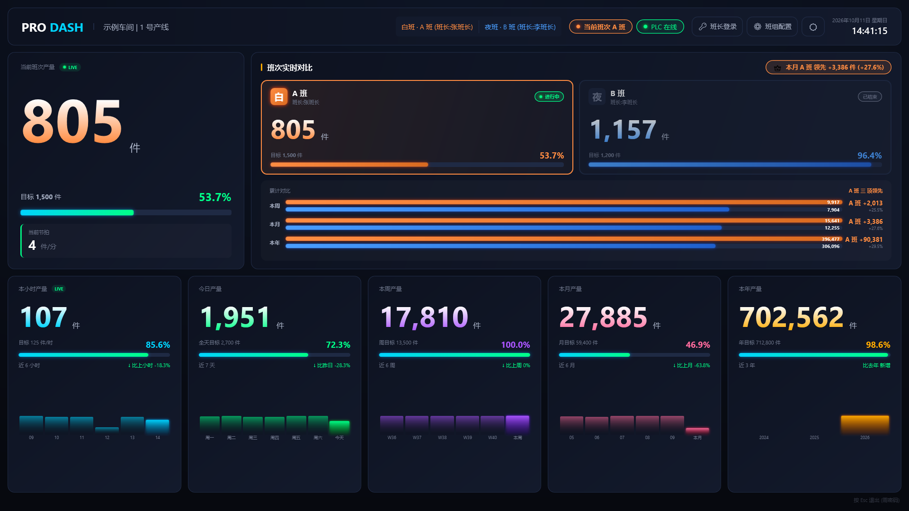
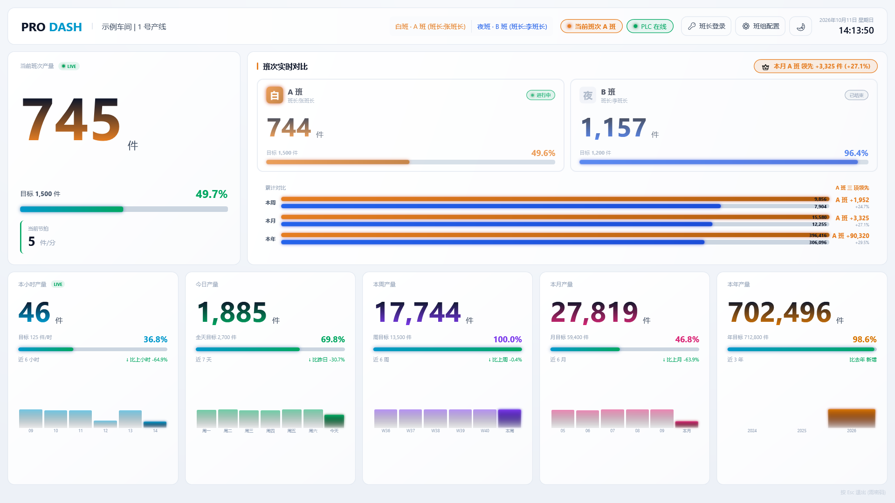
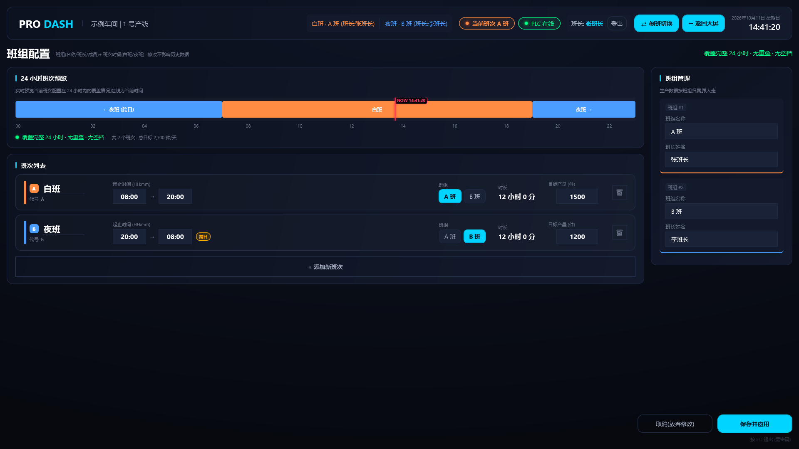

# 生产统计大屏 · ProductionDashboard

**简体中文** | [English](README.en.md)

[](https://github.com/asckye/Production-Dashboard/actions/workflows/ci.yml)
[](LICENSE)


面向离散制造产线 7×24 全时段运行的通用生产统计大屏。PLC 给「完成信号」,上位机做计数 / 班次归属 / 聚合 / 持久化 / 大屏可视化,支持全年(365 天)数据查询导出。

> 适配任意车间 / 产线:改 `appsettings.json` 的 `Display.FactoryName`(顶栏名称)和 `Plc` 节点(PLC 地址)即可,无需改代码。

---

## 界面预览



| 浅色主题 | 班组配置 |
|---|---|
|  |  |

> 截图为演示数据,PLC 信号由 [`tools/plc-sim`](tools/plc-sim) 软件 PLC 模拟。

---

## 特性

- **实时计数** — PLC 信号到 UI 显示 < 200 ms,毫秒级响应
- **5 个时间维度** — 本小时 / 今日 / 本周 / 本月 / 本年,每个维度都有大数字 + 目标百分比 + 趋势对比
- **班组对比** — 实时双班并排 + 周/月/年累计;数据归属跟班组走,倒班后自动结算
- **班次完全可配置** — 1-N 班次、自定义时段、跨日规则、生效日期(操作员页面就能改,不用动代码)
- **PLC 握手模式可选** — 默认上升沿 + 去抖;切到 Handshake 模式后零漏读 + 崩溃可重入(需 PLC 端加 1 个 DWORD 序号字)
- **断点续传** — 工控机断电重启后从 SQLite 恢复当前班次累计,数据无丢失
- **班次结束自动导出 Excel** — 每个班次生成 `Data/Exports/{年}/{日期}_{班次}.xlsx`
- **年度归档** — 跨年自动把上一年数据导出为 `Data/Archives/{年}.xlsx`,清库前另做整库备份,主库清空腾出空间;归档文件从不覆盖
- **看门狗自恢复** — UI 死锁/崩溃 60 秒内识别,杀进程并重启
- **适配各种屏幕** — 界面按 1920×1080 设计、随窗口等比缩放,从 1280×720 到 4K 都完整显示
- **审计留痕** — 班次切换 / PLC 状态变化 / 配置变更全部进 AuditLog 表

---

## 技术栈

| 类别 | 选型 |
|---|---|
| 运行时 | .NET 10 LTS |
| UI | WPF + CommunityToolkit.Mvvm |
| 主机 | Microsoft.Extensions.Hosting (Generic Host) |
| 数据库 | SQLite (WAL 模式) + Dapper |
| PLC 通信 | Sharp7(S7 协议,纯托管) |
| 日志 | Serilog(Console + 滚动文件) |
| 测试 | xUnit + FluentAssertions |
| 部署 | self-contained 单文件 + ReadyToRun (win-x64) |

---

## 快速开始

### 前置

- Windows 10 / 11
- .NET 10 SDK([下载](https://dotnet.microsoft.com/download/dotnet/10.0))
- 一台可达的 Siemens S7 PLC(IP / Rack / Slot 已知);没有硬件时可用 [`tools/plc-sim`](tools/plc-sim) 软件 PLC 代替

### 配置 PLC

编辑 `src/ProductionDashboard/appsettings.json`,改 `Plc` 节点指向真实设备:

```json
"Plc": {
  "IpAddress": "192.168.0.10",
  "Rack": 0,
  "Slot": 1,
  "SampleMode": "Edge",
  "CompleteSignalAddress": "DB100.DBX0.0",
  "HeartbeatAddress": "DB100.DBW6",
  "PollIntervalMs": 100
}
```

> S7-1200 / S7-1500 的 DB 需取消「优化的块访问」才能按绝对地址读写;S7-300/400 一般为 Rack 0 / Slot 2。

### 运行

```powershell
git clone https://github.com/asckye/Production-Dashboard.git
cd Production-Dashboard
dotnet run --project src/ProductionDashboard
```

启动后会依次完成 4 步初始化(可在输出目录的 `logs/app-*.log` 中查看):

1. SQLite 自动建库 + 应用初始迁移 + 注入默认白班 / 夜班 + A 班 / B 班 班组
2. PlcService 连接 PLC,握手成功后日志显示「PLC 已连接」
3. ShiftManager 识别当前班次,激活对应面板
4. 大屏窗口打开,实时数字 + 进度条开始跳动

按 **Esc** 退出,输入密码(默认 `1234`,**部署前请改强密码**)。Alt+F4 或从任务栏关闭同样需要密码。

---

## PLC 通信:Edge vs Handshake

两种采样模式可通过 `appsettings.json` 切换。

### Edge 模式(默认)

```json
"Plc": { "SampleMode": "Edge" }
```

- 上升沿检测 + 200ms 去抖
- 需 PLC 端把完成位**保持至少 200ms**,否则上位机可能在两次轮询(100ms)之间错过

### Handshake 模式(零漏读)

```json
"Plc": {
  "SampleMode": "Handshake",
  "CompleteSignalAddress": "DB100.DBX0.0",
  "CompleteSeqAddress": "DB100.DBD2"
}
```

工作原理:

- PLC 端每次完成事件: `DBD2 := DBD2 + 1; DBX0.0 := TRUE;`
- 上位机识别新序号 → 持久化 → 写 0 清位
- 即使一次轮询窗口跨多个 PLC 触发,通过序号差值都能算出 delta(零漏读)
- 上位机崩溃重启后,读到 bit=1 但序号没变 → 只清位不重复计数(可重入)

**需 PLC 工程师增加** `DB100.DBD2`(DWORD,与完成位同一 DB)字段 + 几行 SCL:

```pascal
IF 检测到完成 AND DB100.DBX0.0 = FALSE THEN
    IF DB100.DBD2 >= 16#FFFFFFFF THEN
        DB100.DBD2 := 0;            // 显式回卷,不依赖 PLC 隐式溢出
    ELSE
        DB100.DBD2 := DB100.DBD2 + 1;
    END_IF;
    DB100.DBX0.0 := TRUE;
END_IF;
```

> 心跳字 `HeartbeatAddress` 需避开序号字占用的字节(DBD2 占 DBB2–DBB5),示例用 `DB100.DBW6`。

---

## 项目结构

三层结构,依赖只能从上往下(由项目引用和架构测试保证):

```
ProductionDashboard.slnx
├── src/
│   ├── ProductionDashboard/                  ← App 层:WPF 界面、ViewModel、看门狗、服务注册(可执行程序)
│   ├── ProductionDashboard.Infrastructure/   ← SQLite 数据访问与迁移、Siemens S7 PLC、Excel 导出、数据库维护
│   └── ProductionDashboard.Core/             ← 业务模型、班次 / 计数 / 统计规则、服务接口(不依赖任何外部技术)
├── tests/ProductionDashboard.Tests/          ← 测试,目录与 src 一一对应 + 分层规则测试
├── tools/plc-sim/                            ← 软件 PLC(本地开发 / 演示用)
├── docs/                                     ← 架构文档、截图
└── .github/                                  ← CI 与发布工作流、Issue / PR 模板
```

**第一次参与开发?请先读 [架构与开发规范](docs/ARCHITECTURE.md)**:目录速查、数据流、编码规则,以及「新增配置 / 新增统计数字 / 修改数据库 / 接入其它 PLC」等常见改动的步骤。

---

## 数据模型

```
ShiftDefinition       班次定义(版本化,改配置不影响历史)
    │
    ▼
ShiftSummary          班次汇总(每班一行: 实际 / 目标 / 峰值 / 备注)
    ▲
    │ (聚合)
    │
ProductionEvent       原始事件(PLC 每发一次完成 = 1 行,含 TeamId)
    │
    ▼ (按分钟聚合)
ProductionMinute      分钟桶(给图表用)

Team / ShiftSlotAssignment  班组主数据 + 槽位↔班组分配
AuditLog                    操作留痕
```

容量估算(1 件 / 秒,全年):

- ProductionEvent: ~3000 万行,约 **1.2 GB**
- ProductionMinute: ~50 万行,约 **30 MB**
- ShiftSummary: ~1500 行(2 班 × 365 天 × ~2 班组)

跨年自动归档到 `Data/Archives/{年}.xlsx`,清库前另存整库备份 `pre-purge-{年}.db`,然后释放主库。同一年再次归档时(例如又补进了该年的数据)另存为带时间戳的新文件,不覆盖之前的归档。

---

## 班次 + 班组配置

启动 UI → 顶栏 **⚙ 班组配置** → 编辑名称 / 起止时间 / 目标产量 / 由哪个班组生产 / 班组名 + 班长 → **保存并应用**。

每个班次都必须选择班组(没有班组的班次产量无法记录)。新增班次会按顺序轮流带出默认班组,应用模板时按顺序沿用原来各班次的班组,保存前可以逐个调整。

支持任意班次时段,例如:

- 单班制:08:00 → 17:00
- 两班倒:08:00–20:00 + 20:00–08:00(默认)
- 三班倒:00:00–08:00 + 08:00–16:00 + 16:00–24:00
- 四班三运转、自定义。时段不能重叠(保存时会拦下);允许有空档(例如单班制夜里不生产),空档里的产量不计入任何班次

**跨日规则**:夜班 20:00 → 次日 08:00,默认归属「结束日」(`Shift.AttributionRule = EndDate`,这样「今天的夜班数据」就是「今天早上结束那一波」,符合现场口语习惯)。

**班次实时对比** — 大屏的两张对比卡片显示排序最靠前的两个班次(默认白班 + 夜班)。三班及以上时,其余班次照常计数,进行中的班次显示在 Hero 大数字和顶栏「当前班次」。

**倒班** — 由班长登录后操作,带审计:顶栏「🔑 班长登录」→「⇄ 倒班切换」→ 确认「白班 ↔ 夜班」对调 → 班组跟人走,数据归属正确切换。

---

## 测试

```powershell
dotnet test
```

当前 **279 个测试全部通过**。主要覆盖:

| 模块 | 覆盖范围 |
|---|---|
| ShiftCalculator / ShiftDefinition / ShiftCoverage / ComparedShifts | 同日 / 跨日 / 1-N 班 / 归属规则(含 24:00 结束)/ 班次时长 / 边界 / 逐分钟覆盖检测(空档、重叠)/ 对比卡片选班 |
| ProductionPeriods / 目标换算 | 本小时按本地整点(含非整点时区)/ 周一为周起点 / 跨月跨年 / 周月年目标 |
| CountingService / MinuteAggregator / 班次结算 | 信号按时间戳归属 / 班次切换 / 倒班数据归属 / 落库失败重试 / 分钟聚合补漏 / 停机后补结算 / Excel 导出 |
| TeamAssignment / AuthService | 班组分配与倒班 / 班长登录 / 空闲超时 / 失败锁定 |
| Repository 集成 / 年度归档 / 数据库维护 | 各仓库 CRUD + 时间窗 + 峰值小时 / 班次配置事务保存 / 归档清库保护、不覆盖旧归档 / VACUUM 调度(真实 SQLite) |
| S7Address / HandshakeDecoder / EdgeDetector / ReconnectBackoff | S7 地址解析 / 序号回卷 / 崩溃重入 / 计数器复位 / 上升沿去抖 / 重连对齐 / 重连退避 |
| ViewModel 展示逻辑 / 界面缩放 | 趋势文字 / 柱图归一化 / 领先判定 / 班次编辑辅助函数 / 按 1920×1080 等比缩放 |
| AlertThrottle | 告警限流:首次放行、间隔内抑制、并发只放行一次 |
| 分层规则(LayeringTests) | Core 不依赖 WPF / 数据库 / PLC;ViewModel 不直接访问仓库 |

---

## 构建与部署

### 直接下载

[Releases](https://github.com/asckye/Production-Dashboard/releases) 页面提供 win-x64 单文件压缩包(发布时由 GitHub Actions 自动构建)。解压后按现场修改 `appsettings.json`(PLC IP、工厂名、口令),双击 `ProductionDashboard.exe` 即可运行,无需安装 .NET。

### 开发构建

```powershell
dotnet build
```

### 单文件 publish(部署到工控机)

```powershell
dotnet publish src/ProductionDashboard -c Release -p:PublishProfile=win-x64 -o publish
```

产物:

- `publish/ProductionDashboard.exe` — 约 **80 MB**,self-contained 单文件,目标机器无需装 .NET 10
- `publish/appsettings.json` — 生产配置(部署前按现场改 PLC IP / 退出密码 / 工厂名)

把 `publish/` 整个目录拷到目标机器,双击 exe 即可运行。

### 看门狗机制

主程序启动时 fork 一个 `--watchdog` 子进程,监视 UI 心跳(`runtime/heartbeat.json`)。心跳由主进程 **UI 线程上的 DispatcherTimer** 写入,所以 UI 死锁 = 心跳停止 = 守护识别。

- 心跳超过 `HeartbeatTimeoutMs`(默认 60 秒)没有更新 → 结束主程序 + 等 3 秒释放句柄 + 重启;主程序没能结束时不重启,避免同时跑两个实例
- 主程序优雅退出 → 写 `gracefulExit=true`,守护读到后直接退出
- 守护日志在 `logs/watchdog-yyyy-MM-dd.log`,与主程序独立

要关掉:`appsettings.json` 加 `"Watchdog": { "Enabled": false }`。

---

## 配置参考

`appsettings.json` 设计上**只放部署相关 + 安全敏感字段**,其余字段的默认值在 `Configuration/*Options.cs` 里,要 override 直接加进 json 即可(类型 + 范围由 `[Range]` / `[Required]` 等校验保证启动期 fail-fast)。

当前 `appsettings.json` 的最小集:

```json
{
  "Serilog": { ... },
  "Plc": {
    "IpAddress": "192.168.0.10",
    "Rack": 0,
    "Slot": 1,
    "SampleMode": "Edge",
    "CompleteSignalAddress": "DB100.DBX0.0",
    "CompleteSeqAddress": "DB100.DBD2",
    "HeartbeatAddress": "DB100.DBW6",
    "PollIntervalMs": 100
  },
  "Display": {
    "FactoryName": "示例车间 | 1 号产线",
    "ExitPassword": "1234",
    "LeaderPassword": "leader"
  }
}
```

要 override 任何默认值(如关全屏、调备份保留天数、切换 PLC SampleMode 为 Handshake 等),按节点加进对应 section 即可。完整字段表参考各 Options 类的 XML 注释。

周 / 月 / 年目标的换算规则可通过 `Targets` 节点调整(默认按工作日计算):

```json
"Targets": {
  "WorkingDaysPerWeek": 5,
  "WorkingDaysPerMonth": 22
}
```

日目标 = 所有班次目标之和;周目标 = 日目标 × `WorkingDaysPerWeek`;月目标 = 日目标 × `WorkingDaysPerMonth`;年目标 = 月目标 × 12。7×24 连续生产的产线可改为 7 / 30。小时目标 = 当前班次目标 ÷ 班次时长。

> 密码也可以用环境变量覆盖,如 `Display__ExitPassword`、`Display__LeaderPassword`,避免把强口令写进配置文件。

---

## 已知限制

- **班次配置版本化** — `ShiftDefinition` 表已有 `EffectiveFrom` / `EffectiveTo` 字段,软删除走通,但 UI 上没有「历史版本回看」。改完即生效,过往数据按当时的目标值已落库。
- **良品率** — 当前不跟踪缺陷,UI 上已隐藏良品率 metric。需要时可扩展 `ProductionEvent` 加 `Quality` 字段。
- **PLC Handshake 模式** — 需要 PLC 程序配合增加序号双字(示例 `DB100.DBD2`)后才能切换;默认 Edge 模式无需改 PLC 程序。
- **仅支持 Siemens S7** — 通信层基于 Sharp7;接入其它品牌 PLC 需实现 `IPlcService`(参考 `Plc/PlcServiceBase.cs`)。

---

## 参与贡献

欢迎提交 issue 和 PR!开始之前请阅读:

- [架构与开发规范](docs/ARCHITECTURE.md):分层规则、目录速查、常见改动步骤
- [贡献指南](CONTRIBUTING.md):开发环境、无 PLC 本地运行、代码约定、提交规范
- [行为准则](CODE_OF_CONDUCT.md)
- [安全策略](SECURITY.md):安全漏洞请私下报告,不要公开提交 issue
- [更新日志](CHANGELOG.md)

---

## License

[MIT](LICENSE)
