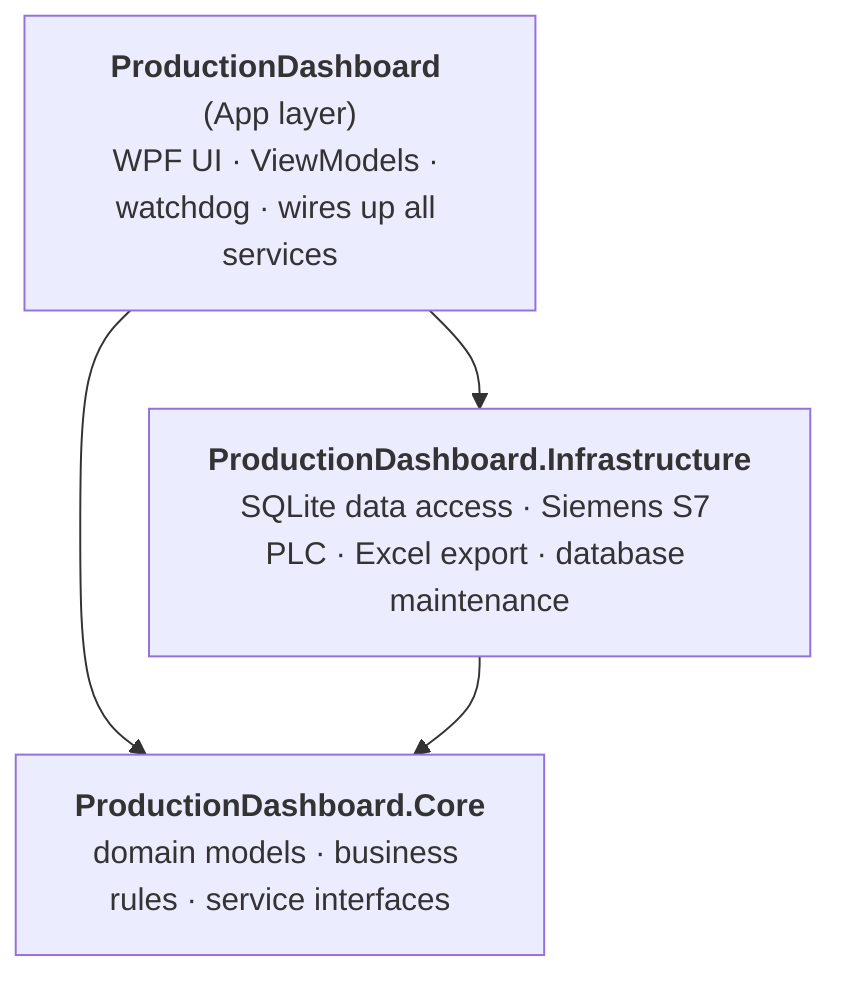
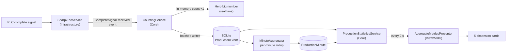

# Architecture and Development Guidelines

[简体中文](ARCHITECTURE.md) | [English](ARCHITECTURE.en.md)

This guide is for developers who are new to the project. After reading it you should know **where code lives, which way dependencies go, and how to make common changes**.

---

## 1. Three layers



Arrows mean "references / depends on". **Dependencies only point downward**: Core knows nothing about the database or the UI, and Infrastructure knows nothing about the UI.

| Project | Contains | Must not contain |
|---|---|---|
| `ProductionDashboard.Core` | Domain models (shifts, teams, production events), business rules (shift calculation, counting, statistics, target rules), service interfaces and implementations, repository **interfaces** | WPF, SQL, Sharp7, ClosedXML or any other concrete technology |
| `ProductionDashboard.Infrastructure` | Implementations of Core interfaces: SQLite repositories and migrations, Sharp7 PLC communication, ClosedXML export, database maintenance jobs | WPF or UI logic |
| `ProductionDashboard` (App) | WPF windows and views, ViewModels, UI services (toasts / theme / dialogs), watchdog, service registration (composition root) | Raw SQL or direct repository calls |

Two safeguards enforce these rules:

1. **Project references**: Core does not reference Infrastructure or WPF at all, so a violation is a compile error.
2. **Architecture tests** in [`LayeringTests`](../tests/ProductionDashboard.Tests/Architecture/LayeringTests.cs) check the assemblies each layer references, and that **ViewModels never depend on repositories (`I*Repository`) or Infrastructure types**. A violation fails the test with a message explaining the right approach.

---

## 2. Where things live

```
src/
├── ProductionDashboard.Core/
│   ├── Shifts/          shift definitions, teams, shift calculation (ShiftCalculator), ShiftManager, team assignment, saving team & shift settings
│   ├── Production/      production events, counting (CountingService), per-minute aggregation, shift summaries and settlement
│   ├── Statistics/      dashboard statistics (IProductionStatisticsService), period boundaries, target rules
│   ├── Auth/            team-leader login and exit password
│   ├── Diagnostics/     audit subscription, global exception hub
│   ├── Plc/             IPlcService interface (abstraction of the PLC signal)
│   ├── Export/          IExcelExportService interface
│   └── DependencyInjection/  Core service registration methods
├── ProductionDashboard.Infrastructure/
│   ├── Persistence/     SQLite connections, database initialization, audit log writer
│   │   ├── Repositories/    repository implementations (all SQL lives here)
│   │   └── Migrations/      database migration scripts
│   ├── Plc/             Sharp7 Edge / Handshake implementations, S7 address parsing
│   ├── Export/          ClosedXML Excel export
│   ├── Maintenance/     daily VACUUM and backup, yearly archive, system health checks
│   └── DependencyInjection/  Infrastructure service registration methods
└── ProductionDashboard/
    ├── App.xaml.cs      entry point and the "wiring diagram" RegisterServices (every service is registered here, in startup order)
    ├── Configuration/   UI options (DisplayOptions / WatchdogOptions) and DI registration
    ├── ViewModels/      MainViewModel / DashboardViewModel / ShiftConfigViewModel and their presenters
    ├── Views/           XAML views and dialogs
    ├── Services/UI/     toasts, theme, dialogs, UI heartbeat
    ├── Controls/ · Converters/ · Resources/   reusable controls, value converters, styles and themes
    └── Watchdog/        watchdog child process and heartbeat file
tests/ProductionDashboard.Tests/
    ├── Core/ · Infrastructure/ · App/   mirror the src layout
    ├── Architecture/    layering rule tests
    └── Helpers/         test utilities (controllable clock, etc.)
```

**Convention: folder = namespace.** For example, `src/ProductionDashboard.Core/Shifts/ShiftManager.cs` is in the `ProductionDashboard.Core.Shifts` namespace.

---

## 3. How one part gets counted



- **Real-time numbers** (current shift output) come from `CountingService`'s in-memory counts, with no database round trip, so latency is very low.
- **Statistics** (this hour / today / this week…) are queried and computed by `ProductionStatisticsService` every 2 seconds; the ViewModel only turns numbers into text and bar heights.
- **Shift changes** are detected by `ShiftManager` every 30 seconds and trigger shift summaries, settlement and the Excel export.

---

## 4. Coding rules

### Dependencies and layers
- ViewModels depend only on **Core services** (such as `IProductionStatisticsService`, `IShiftConfigurationService`, `IShiftManager`) and App UI services (such as `IToastService`, `IDialogService`), **never on repositories**.
- ViewModels do not `new` up windows; they open dialogs through `IDialogService`.
- Every service gets its dependencies through **constructor injection**; there is no static service locator.
- New business rules go into Core, preferably as **pure functions** (same input, same output) so they are easy to unit-test.

### Time
- Business code reads the current time from the injected **`TimeProvider`**, never `DateTime.Now` directly. Tests can swap in `ControlledTimeProvider`.
- Event timestamps are stored in the database as **UTC**; day / week / month / year statistics use the **shift attribution date (ShiftDate, a local date)**.
- "This hour" and other windows start at the local full hour; compute them with `ProductionPeriods` instead of building boundaries by hand.

### Configuration
- Each configuration section maps to one `XxxOptions` class with a `SectionName` constant and `[Range]` / `[Required]` validation attributes; defaults are property initializers.
- Register a new options class with one `AddValidatedOptions` line in `OptionsRegistration`; invalid configuration fails at startup.
- `appsettings.json` only holds values that change per deployment; everything else uses defaults.

### Naming
| Kind | Pattern | Example |
|---|---|---|
| Interface | `I` + noun | `IShiftManager` |
| Business service | `XxxService` / `XxxManager` | `CountingService` |
| Data access | `IXxxRepository` (Core) + `XxxRepository` (Infrastructure) | `ITeamRepository` |
| Background job | `XxxHostedService` | `AggregationHostedService` |
| Options | `XxxOptions` | `PlcOptions` |
| Tests | class under test + `Tests`; methods named `what_under_which_condition_gives_what` | `Week_starts_on_monday` |

### Comments
- Public types and members carry **Chinese XML doc comments** (`/// <summary>`) explaining what and why, not which version changed them.
- Inline comments only where the logic is not obvious.

---

## 5. How to make common changes

### Add a configuration setting
1. Add a property with a default value and validation attributes to the relevant `XxxOptions` class.
2. For a new section: create an `XxxOptions` class and add one line to [`OptionsRegistration`](../src/ProductionDashboard/Configuration/DI/OptionsRegistration.cs).
3. Inject `IOptions<XxxOptions>` into the services that need it.
4. Document it in the "Configuration reference" of both READMEs.

### Add a number to the dashboard
1. Add a field to Core's `DashboardStatistics` and compute it in `ProductionStatisticsService` (if it needs a new query, add a method to `IProductionAnalyticsRepository` first, then implement it in Infrastructure's `ProductionAnalyticsRepository`).
2. Add a matching UI property to `AggregateMetricsPresenter` and format the number as text.
3. Bind the property in XAML. Design the layout at 1920×1080; the main window's `DesignScaleDecorator` scales it proportionally to the actual window size, so other resolutions need no separate work.
4. Add unit tests for the Core calculation.

### Change the database schema
1. **Append** a new migration version to [`MigrationCatalog`](../src/ProductionDashboard.Infrastructure/Persistence/Migrations/MigrationCatalog.cs). **Never edit a released migration**: deployed databases will not re-run it.
2. Update the models and repositories, and extend `RepositoriesIntegrationTests`.

### Support another PLC brand
1. Add an implementation in Infrastructure that derives from `PlcServiceBase` (or implements Core's `IPlcService` directly).
2. Select it by configuration in `InfrastructureServiceRegistration.AddProductionDashboardPlc`.
3. Core and the UI need no changes.

### Add a background job
1. Implement `IHostedService` (or derive from `BackgroundService`) in the layer it belongs to.
2. Add a registration method to that layer's `XxxServiceRegistration`, and call it from `RegisterServices` in `App.xaml.cs` **in dependency order** (background jobs start in registration order).

---

## 6. Tests

```powershell
dotnet test                                              # all tests
dotnet test --filter "Category!=Performance"             # skip performance benchmarks (what CI does)
dotnet test --filter "FullyQualifiedName~Architecture"   # layering rules only
```

- The test folders mirror the source: tests for `src/ProductionDashboard.Core/Shifts/ShiftCalculator.cs` live in `tests/ProductionDashboard.Tests/Core/Shifts/ShiftCalculatorTests.cs`.
- Dependencies are replaced with small hand-written stubs; time comes from `Helpers/ControlledTimeProvider`.
- Repository tests use real temporary SQLite files (`RepositoriesIntegrationTests`).
- Without PLC hardware, use the [`tools/plc-sim`](../tools/plc-sim) software PLC for end-to-end checks.
