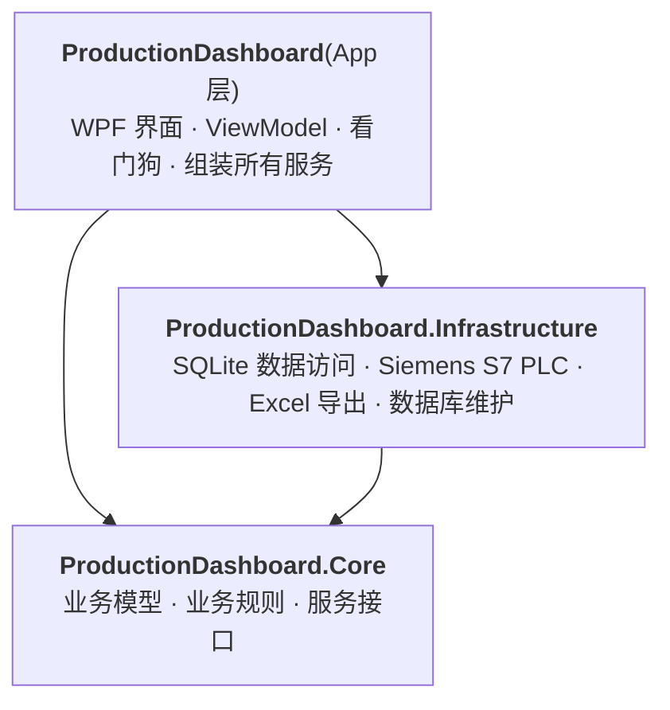
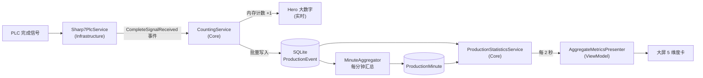

# 架构与开发规范

[简体中文](ARCHITECTURE.md) | [English](ARCHITECTURE.en.md)

本文面向第一次接触本项目的开发者:读完后你应该知道**代码放在哪、依赖怎么走、常见改动怎么做**。

---

## 1. 三层结构



箭头表示「引用 / 依赖」。**依赖只能从上往下**:Core 不知道数据库和界面的存在,Infrastructure 不知道界面的存在。

| 项目 | 放什么 | 不能放什么 |
|---|---|---|
| `ProductionDashboard.Core` | 领域模型(班次、班组、生产事件)、业务规则(班次计算、计数、统计、目标换算)、服务接口与实现、仓库**接口** | WPF、SQL、Sharp7、ClosedXML 等任何具体技术 |
| `ProductionDashboard.Infrastructure` | Core 接口的具体实现:SQLite 仓库与迁移、Sharp7 PLC 通信、ClosedXML 导出、数据库维护后台任务 | WPF、界面逻辑 |
| `ProductionDashboard`(App) | WPF 窗口与视图、ViewModel、界面服务(Toast / 主题 / 对话框)、看门狗、服务注册(组合根) | 直接写 SQL 或调用仓库 |

这些规则由两道关卡保证:

1. **项目引用**:Core 根本没有引用 Infrastructure 和 WPF,写错了直接编译失败。
2. **架构测试** [`LayeringTests`](../tests/ProductionDashboard.Tests/Architecture/LayeringTests.cs):检查各层引用的程序集,以及 **ViewModel 不得直接依赖仓库(`I*Repository`)或 Infrastructure 类型**。违反时测试失败并提示正确做法。

---

## 2. 目录速查

```
src/
├── ProductionDashboard.Core/
│   ├── Shifts/          班次定义、班组、班次计算(ShiftCalculator)、ShiftManager、班组分配、班组配置保存
│   ├── Production/      生产事件、计数服务(CountingService)、分钟聚合、班次汇总与结算
│   ├── Statistics/      大屏统计(IProductionStatisticsService)、统计时段、目标换算规则
│   ├── Auth/            班长登录与退出口令
│   ├── Diagnostics/     审计订阅、全局异常汇集
│   ├── Plc/             IPlcService 接口(PLC 信号的抽象)
│   ├── Export/          IExcelExportService 接口
│   └── DependencyInjection/  Core 服务注册方法
├── ProductionDashboard.Infrastructure/
│   ├── Persistence/     SQLite 连接、数据库初始化、审计日志写库
│   │   ├── Repositories/    各仓库实现(SQL 都在这里)
│   │   └── Migrations/      数据库迁移脚本
│   ├── Plc/             Sharp7 Edge / Handshake 两种实现、S7 地址解析
│   ├── Export/          ClosedXML Excel 导出
│   ├── Maintenance/     每日 VACUUM 与备份、年度归档、系统巡检
│   └── DependencyInjection/  Infrastructure 服务注册方法
└── ProductionDashboard/
    ├── App.xaml.cs      程序入口与「接线图」RegisterServices(所有服务在这里按启动顺序注册)
    ├── Configuration/   界面配置(DisplayOptions / WatchdogOptions)与 DI 注册
    ├── ViewModels/      MainViewModel / DashboardViewModel / ShiftConfigViewModel 及其子 presenter
    ├── Views/           XAML 视图与对话框
    ├── Services/UI/     Toast、主题、对话框、UI 心跳
    ├── Controls/ · Converters/ · Resources/   可复用控件、值转换器、样式与主题
    └── Watchdog/        看门狗子进程与心跳文件
tests/ProductionDashboard.Tests/
    ├── Core/ · Infrastructure/ · App/   与 src 一一对应
    ├── Architecture/    分层规则测试
    └── Helpers/         测试工具(可控时钟等)
```

**约定:文件夹 = 命名空间。** 例如 `src/ProductionDashboard.Core/Shifts/ShiftManager.cs` 的命名空间是 `ProductionDashboard.Core.Shifts`。

---

## 3. 一个零件被计数的全过程



- **实时数字**(当前班次产量)来自 `CountingService` 的内存计数,不查数据库,所以延迟很低。
- **统计数字**(本小时 / 今日 / 本周……)由 `ProductionStatisticsService` 每 2 秒查一次数据库并计算好,ViewModel 只负责把数字变成文字和柱高。
- **班次切换**由 `ShiftManager` 每 30 秒检测,触发班次汇总、结算和 Excel 导出。

---

## 4. 编码规则

### 依赖与分层
- ViewModel 只依赖 **Core 服务**(如 `IProductionStatisticsService`、`IShiftConfigurationService`、`IShiftManager`)和 App 层的界面服务(如 `IToastService`、`IDialogService`),**不直接访问仓库**。
- ViewModel 不直接 `new` 窗口,通过 `IDialogService` 弹出对话框。
- 所有服务通过**构造函数注入**获得依赖,不使用静态服务定位。
- 新的业务规则写在 Core,优先写成**纯函数**(相同输入总得到相同输出),方便单元测试。

### 时间
- 业务代码一律通过注入的 **`TimeProvider`** 读取当前时间,不要直接使用 `DateTime.Now`。测试时可以换成 `ControlledTimeProvider`。
- 数据库中事件时间存 **UTC**;日 / 周 / 月 / 年统计按**班次归属日期(ShiftDate,本地日期)**。
- 「本小时」等以本地整点为界,用 `ProductionPeriods` 计算,不要自己拼时间边界。

### 配置
- 每个配置节点对应一个 `XxxOptions` 类,包含 `SectionName` 常量和 `[Range]` / `[Required]` 校验特性,默认值写在属性上。
- 新配置类在 `OptionsRegistration` 加一行 `AddValidatedOptions` 即可,配置不合法时程序启动即报错。
- `appsettings.json` 只放部署时需要修改的项,其余用默认值。

### 命名
| 类型 | 命名 | 示例 |
|---|---|---|
| 接口 | `I` + 名词 | `IShiftManager` |
| 业务服务 | `XxxService` / `XxxManager` | `CountingService` |
| 数据访问 | `IXxxRepository`(Core)+ `XxxRepository`(Infrastructure) | `ITeamRepository` |
| 后台任务 | `XxxHostedService` | `AggregationHostedService` |
| 配置 | `XxxOptions` | `PlcOptions` |
| 测试 | `被测类名 + Tests`,方法名用 `做什么_在什么条件下_得到什么` | `Week_starts_on_monday` |

### 注释
- 公共类型和成员写**中文 XML 文档注释**(`/// <summary>`),说明「做什么、为什么」,不写「哪个版本改的」。
- 只在逻辑不直观的地方写行内注释。

---

## 5. 常见改动怎么做

### 新增一个配置项
1. 在对应层的 `XxxOptions` 类加属性,写默认值和校验特性。
2. 如果是新的配置节点:新建 `XxxOptions` 类,在 [`OptionsRegistration`](../src/ProductionDashboard/Configuration/DI/OptionsRegistration.cs) 加一行。
3. 在需要的服务构造函数里注入 `IOptions<XxxOptions>`。
4. 在 README(中 / 英)的「配置参考」补充说明。

### 在大屏上新增一个统计数字
1. 在 Core 的 `DashboardStatistics` 加字段,在 `ProductionStatisticsService` 里计算(需要新查询时,先在 `IProductionAnalyticsRepository` 加方法,再在 Infrastructure 的 `ProductionAnalyticsRepository` 实现)。
2. 在 `AggregateMetricsPresenter` 加对应的界面属性,把数字格式化成文字。
3. 在 XAML 中绑定该属性。布局按 1920×1080 设计即可,主窗口的 `DesignScaleDecorator` 会按实际窗口大小等比缩放,不需要为其它分辨率单独适配。
4. 为 Core 的计算逻辑补单元测试。

### 修改数据库结构
1. 在 [`MigrationCatalog`](../src/ProductionDashboard.Infrastructure/Persistence/Migrations/MigrationCatalog.cs) **追加**一个新版本的迁移,**不要修改已发布的迁移**(已部署的数据库不会重跑旧迁移)。
2. 更新对应的模型和仓库,补 `RepositoriesIntegrationTests`。

### 接入其它品牌的 PLC
1. 在 Infrastructure 新建实现,继承 `PlcServiceBase`(或直接实现 Core 的 `IPlcService`)。
2. 在 `InfrastructureServiceRegistration.AddProductionDashboardPlc` 中按配置选择该实现。
3. Core 与界面层无需改动。

### 新增一个后台任务
1. 实现 `IHostedService`(或继承 `BackgroundService`),放在它所属的层。
2. 在该层的 `XxxServiceRegistration` 加注册方法,并在 `App.xaml.cs` 的 `RegisterServices` 中**按依赖顺序**调用(后台任务按注册顺序启动)。

---

## 6. 测试

```powershell
dotnet test                                          # 全部测试
dotnet test --filter "Category!=Performance"         # 跳过性能基准(CI 的做法)
dotnet test --filter "FullyQualifiedName~Architecture"   # 只跑分层规则测试
```

- 测试目录与源码一一对应:`src/ProductionDashboard.Core/Shifts/ShiftCalculator.cs` 的测试在 `tests/ProductionDashboard.Tests/Core/Shifts/ShiftCalculatorTests.cs`。
- 依赖用手写的小桩(Stub)替换,时间用 `Helpers/ControlledTimeProvider`。
- 仓库测试使用真实 SQLite 临时文件(`RepositoriesIntegrationTests`)。
- 没有 PLC 硬件时,可以用 [`tools/plc-sim`](../tools/plc-sim) 软件 PLC 做联调。
